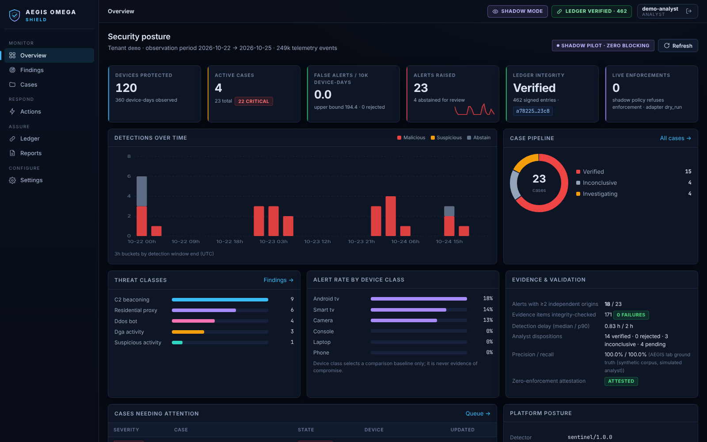

# AEGIS OMEGA SHIELD

**Evidence-first detection of compromised devices and botnet infrastructure for ISPs and network operators.**
Read-only by default. Every alert cites its evidence. Nothing is ever blocked without a signed operator policy,
a passing impact simulation and a second human.

SHIELD reads the telemetry an operator already has (NetFlow/IPFIX, resolver DNS logs, Zeek, CPE/gateway
telemetry) and finds subscriber devices that behave like compromised hosts: periodic C2 beaconing from
pre-infected TV boxes, residential-proxy egress, DGA lookups, DDoS-bot bursts. For each finding it builds a
case with the evidence, the alternative benign explanations it checked, and a signed, tamper-evident audit
trail. Where an operator later chooses to act, the proposed action is simulated against its hosting topology
first, so a shared CDN address is not blocked because one tenant behind it is malicious.

| | |
|---|---|
| **Deployment** | One container + PostgreSQL on a single host, on-prem or sovereign cloud (`docker compose`). Same image for hosted SaaS. |
| **Data** | Flow and DNS security metadata only. No payloads, no TLS decryption. Subscriber identifiers are replaced by tenant-keyed pseudonyms at ingest. |
| **Mode** | Shadow (alerts and reports, zero blocking) unless the operator loads a signed `active` policy with a legal sign-off reference. |
| **AI** | Optional. The full detection path runs with no LLM. When enabled, an LLM can help write investigation summaries; it cannot change policy, models or enforcement. |
| **Assurance** | Hash-chained Ed25519-signed ledger, replay of any decision "as known at time T", per-tenant isolation, four-eyes approval, rollback with circuit breaker. |



## Try it in two minutes

```bash
docker compose -f deploy/docker-compose.demo.yml up --build
# open http://localhost:8080 and pick a role (analyst, approver, admin, viewer)
```

The demo generates a synthetic lab network (Android TV boxes, smart TVs, consoles, a busy legitimate IPTV
box, emulated BadBox/Vo1d-style malware), runs detection, opens cases and verifies the ledger. It runs in
shadow mode, so the action workflow ends in a refusal by design. A guided walkthrough is in
[docs/sales/DEMO_SCRIPT.md](docs/sales/DEMO_SCRIPT.md).

Without Docker: `pip install -e ".[dev]" && aegis demo` (Python 3.11+). The console is served on http://127.0.0.1:8000 (loopback only: the demo hands out sign-in tokens without credentials; pass `--host` explicitly to expose it).

## Deploy a pilot

```bash
cp deploy/.env.example deploy/.env && chmod 600 deploy/.env   # fill in every REQUIRED value
docker compose -f deploy/docker-compose.yml up -d --build      # PostgreSQL + API + console
docker compose -f deploy/docker-compose.yml --profile monitoring up -d   # + Prometheus and Grafana
```

Then register telemetry sources, connect your identity provider and push collector files with
`deploy/tools/aegis_push.py`. The full procedure, sizing, TLS, backup and upgrade steps are in
[docs/INSTALL.md](docs/INSTALL.md).

## How it works

```
collectors (NetFlow/IPFIX, resolver DNS, Zeek, CPE)          signed IOC bundles, hosting topology
        |                                                               |
   ingest: parse -> validate -> pseudonymize -> quarantine bad records (original bytes kept)
        |
   SENTINEL: 5m/15m/24h windows -> signed IOC rules + calibrated LightGBM + anomaly + change-point
        |    -> pre-registered fusion with ABSTAIN when context is short
   PROVENANCE: evidence store (SHA-256) + hash-chained signed ledger + snapshots + replay
        |
   CONSTELLATION temporal graph  ->  ORACLE cases: counter-hypothesis review, bounded investigation
        |
   MIRROR: impact simulation (co-tenants, collateral, reversibility) -> authorize() -> four-eyes
        |    -> adapter (dry-run | RPZ | webhook) with circuit breaker and rollback
   API (OIDC, RBAC, per-tenant) + analyst console + shadow proof-of-value report
```

Module contracts: [docs/ARCHITECTURE.md](docs/ARCHITECTURE.md). The RESONANCE cross-subscriber beacon
detector is described in [docs/RESONANCE.md](docs/RESONANCE.md).

## Documentation

| For | Read |
|---|---|
| Operators deploying a pilot | [Install guide](docs/INSTALL.md) · [Configuration reference](docs/CONFIGURATION.md) · [Telemetry integration](docs/OPERATOR_INTEGRATION.md) |
| SOC / NOC | [Runbooks](docs/runbooks/) · [SLOs](docs/SLO.md) · Grafana dashboard `deploy/grafana/dashboards/aegis-shield.json` |
| Security reviewers | [Security architecture and threat model](docs/SECURITY_ARCHITECTURE.md) · [SECURITY.md](SECURITY.md) |
| DPO and counsel | [Data map](docs/compliance/DATA_MAP.md) · [DPIA template](docs/compliance/DPIA_TEMPLATE.md) · [French/EU regulatory context](docs/compliance/REGULATORY_CONTEXT_FR_EU.md) |
| Buyers | [Product sheet](docs/sales/PRODUCT_SHEET.md) · [Shadow pilot offer](docs/sales/SHADOW_PILOT_OFFER.md) · [Security questionnaire](docs/sales/SECURITY_QUESTIONNAIRE.md) |

## Principles

* No one is judged on a single source: a case is verified only with two independent origins or a signed
  indicator, after the benign explanations were reviewed.
* We never accuse without evidence, and we never claim more than we can prove.
* Honest measures, published limits.
* We protect people's privacy as we would want ours protected.
* Act justly, show mercy, admit what we do not know: abstain is a first-class outcome, humans approve
  consequential actions, and every action is reversible.

## What SHIELD does not claim

Detection quality is measured, not asserted. The shipped model and benchmark run on a synthetic lab corpus;
lab numbers describe the lab only. Field performance is established per operator during the shadow pilot,
against success criteria agreed before it starts, and reported with base rates, confidence intervals and
false alerts per 10,000 device-days. See [docs/sales/CLAIMS_GUIDE.md](docs/sales/CLAIMS_GUIDE.md).

SHIELD never infers compromise from device class, vendor, IPTV app usage or geography alone. Device class
selects a comparison baseline; it is never evidence.

## Development

```bash
make install      # editable install with dev, postgres and llm extras
make check        # ruff + pytest (incl. spec section 15 safety tests) + console tests
make image smoke  # build the image and run the compose end-to-end smoke test
make help         # everything else (sbom, audit, backup, ...)
```

CI ([.github/workflows/ci.yml](.github/workflows/ci.yml)) runs lint, the test suite on Python 3.11 and 3.12
(ledger tests also against PostgreSQL), the console build and tests, `pip-audit` and `npm audit`, CycloneDX
SBOMs, promtool rule tests, and a container build with an end-to-end compose smoke test. Tagged releases are
signed with Sigstore cosign and carry an SBOM attestation ([release.yml](.github/workflows/release.yml)).

## License

Proprietary. Copyright AEGIS OMEGA. Evaluation and pilot use under the terms of the applicable agreement.
